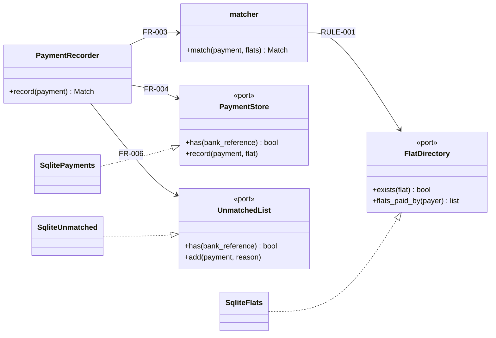

## 12. Components — inside the code

*Added in Session 10. Section 3 says which pieces talk to the outside world; this section says how
the code inside is cut up, so that one change stays in one place.*

**The direction rule:** dependencies point *towards* the rule. The rule (`matcher`) depends on
nothing but the model and the ports. Databases and frameworks are on the outside, plugged in.

| Component | Its one job — no "and" | Exposes | Depends on (interfaces only) | Pattern, if any | Requirement IDs |
|---|---|---|---|---|---|
| `flat_in_remark` | Finds a flat number in a remark | `flat_in_remark(remark)` | — | — | RULE-001a, RULE-001b |
| `matcher` | Applies RULE-001 to one payment | `match(payment, flats)` | `FlatDirectory` port | — | RULE-001, FR-003 |
| `record_payment` | Records one payment, once | `PaymentRecorder.record(payment)` | `FlatDirectory`, `PaymentStore`, `UnmatchedList` ports | Use case (service) | FR-003, FR-004, FR-006 |
| `ports` | Says what the rule needs from outside | three interfaces | — | Ports | E-004 |
| `sqlite_store` | Keeps what the slice stores, in SQLite | adapters for the three ports | a database connection, passed in | Repository / adapter | FR-004, C-001 |
| `model` | Gives the spec's words a type | `Payment`, `Match`, `UnmatchedReason` | — | — | E-001 |

Patterns are listed only where the problem actually appears. A component with no pattern is fine.

