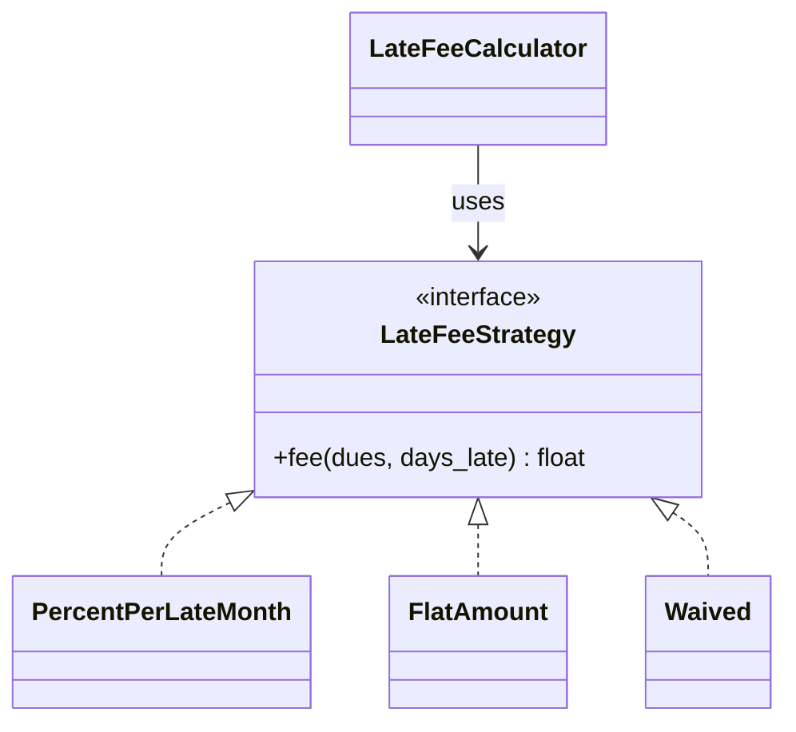

# From pattern to plan §12 and constitution §5

Patterns live in two places in your specs:

- **plan §12 (components)** says *where* a pattern is used — the **Pattern** column, plus a class
  diagram for anything with an interface and more than one implementation.
- **constitution §5 (engineering rules)** says *how the whole codebase behaves* — only for patterns
  that become a rule everyone follows (for example "all database access goes through repositories").

Most patterns stay in the plan. Only a few become constitution rules.

## Step 1 · Find the situation in your spec

Read your `spec.md` and `plan.md` with the table in [`README.md`](README.md) next to you. For each
row, write the requirement ID that matches — or "none". **"None" is a good answer.**

## Step 2 · Fill the Pattern column in plan §12

```markdown
| Component | Its one job — no "and" | Exposes | Depends on (interfaces only) | Pattern, if any | Requirement IDs |
|---|---|---|---|---|---|
| UpiJsonAdapter | Turn the UPI partner's file into Payments | PaymentSource | — | Adapter | FR-001 |
| BankCsvAdapter | Turn the bank statement into Payments | PaymentSource | — | Adapter | FR-002 |
| LateFeeCalculator | Work out the amount due for a unit | amount_due() | LateFeeStrategy | Strategy | FR-004 |
| SqlitePaymentRepository | Save and find payments | PaymentRepository | — | Repository | FR-001, C-001 |
| RecordCashPayment | Record one cash payment for one flat | run() | Payments, Flats | Use case | FR-006 |
| Matcher | Match a payment to a flat and announce it | match() | PaymentRepository, EventPublisher | Publisher | FR-003 |
| normalise_flat() | Tidy a flat number (trim, upper case) | function | — | — | FR-001 |
```

The last row matters: **not everything needs a pattern**.

## Step 3 · Add a class diagram where there is an interface



## Step 4 · Promote to the constitution only what is codebase-wide

| Pattern | Constitution row — copy only if it is true for your **whole** codebase | Checked by |
|---|---|---|
| Adapter | `E-016` Outside formats stop at an adapter — no partner field names past `adapters/` | Review; a pipeline grep for partner field names |
| Strategy | `E-013` A rule that varies by type is one strategy per variant — no if/elif chain on the type | Review; a test that adds a variant |
| Repository | `E-017` All database access is inside repositories; every query uses parameters | Review; ruff S608 / SpotBugs / eslint-plugin-security |
| Use case | `E-018` One use case per user goal, verb + object; controllers only translate and call | Review against plan §12 |
| Publisher | `E-019` Follow-ups to an event are listeners, not calls inside the component that raised it | Review against plan §12 |

E-001…E-012 come from `templates/engineering-rules.md`; E-013…E-015 are the optional SOLID rows in
[`../principles/in-your-constitution.md`](../principles/in-your-constitution.md). Renumber freely —
the IDs only need to be unique **in your constitution**.

## Step 5 · Let the assistant draft, then decide yourselves

```text
/spec-components specs/001-<slice>
```

It proposes §12 with patterns. For every pattern it proposes, ask: **which requirement needs this?**
No requirement → cross it out. Record the change in `plan.md` and merge it through the gate like
any other change.
