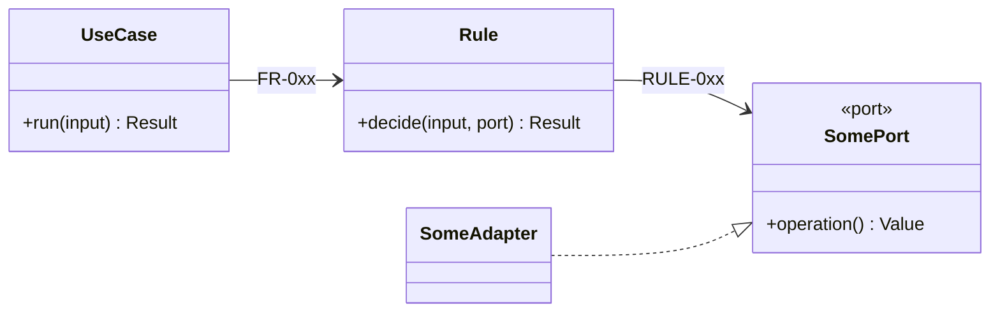

## 12. Components — inside the code

*Section 3 says which pieces talk to the outside world. This section says how the code inside is
cut up, so that one change stays in one place.*

**The direction rule:** dependencies point towards the rule. The rule depends only on the model and
on interfaces (ports). Databases, frameworks and other systems sit outside and are plugged in.

| Component | Its one job — no "and" | Exposes | Depends on (interfaces only) | Pattern, if any | Requirement IDs |
|---|---|---|---|---|---|
| | | | | | |

List a pattern only where its problem actually appears. A component with no pattern is fine.

