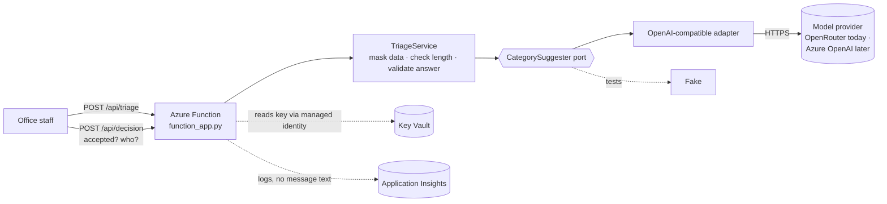

# Session 12 · A very simple AI feature, on Azure

A worked example for the Session 12 workshop: **one AI-assisted feature, built the safe way, and
deployed to Azure.** It is deliberately small, so you can read all of it in fifteen minutes and then
build *your* feature for *your* case the same way.

> **The feature:** a resident writes to the housing-society office. The system **suggests** a category
> (repair, dues, noise, security, booking, other) and one sentence of reason. **A person decides.**
> The example is invented — it is not any group's case.

## The five rules it follows

| Rule | Where you see it |
|---|---|
| **1 · The AI suggests; a person decides** | `/api/triage` only suggests (`decided_by` is always empty). `/api/decision` records who accepted or rejected |
| **2 · Spec first** | `spec/ai-feature-spec.md` — FRs, *If* rows, a data rule, a short ADR — written before the code |
| **3 · Behind a port** | `triage/ports.py`. Only `triage/adapters/openai_compatible.py` knows a model exists |
| **4 · Never trust the answer** | `triage/service.py` — not JSON, or not on the list → thrown away. Failure → "no suggestion", never a crash |
| **5 · The eval set is its test** | `eval/eval_set.json` — clear, unclear and guardrail examples, each with a source |

## How it fits together



## Files

```
function_app.py              Azure Functions (Python v2 model) - thin: request in, JSON out
triage/model.py              categories, limits, the result shape
triage/ports.py              the port, and SuggesterUnavailable
triage/service.py            the rules: mask, check, call, never trust
triage/prompt.txt            the system prompt - the message is data, not instructions
triage/adapters/             openai_compatible.py (real) · fake.py (tests, and no-key runs)
triage/cli.py                try it on your laptop without Azure
eval/                        eval_set.json + run_eval.py (exits non-zero if a guardrail breaks)
tests/                       every If row tested with a fake - no key, no network
spec/ai-feature-spec.md      the spec change that came first
deploy/deploy.sh · .ps1      one script to Azure: Functions + Key Vault + App Insights
```

## 1 · Run it on your laptop (no Azure, no key)

```bash
cd 09a-session12-azure-ai-feature
python -m venv .venv && source .venv/bin/activate        # Windows: .venv\Scripts\activate
pip install -r requirements-dev.txt
python -m pytest -q                                      # all tests pass with the fake
python -m triage.cli "There is a leak in the lift lobby" # suggested_by: fake
```

With a model (the vlabs OpenRouter key works — it speaks the same protocol):

```bash
export MODEL_BASE_URL=https://openrouter.ai/api/v1
export MODEL_NAME="<a model id your key can use>"
export MODEL_API_KEY="<your key>"                        # environment only - never in a file you commit
python -m triage.cli "Loud music from the 4th floor every night"
python -m eval.run_eval                                  # how often does it agree with the office?
```

## 2 · Deploy it to Azure

What the script creates (all allowed by the lab policy, all in `eastus`): a resource group, a
storage account, a **Function App on the Flex Consumption plan (Python 3.11)** with Application
Insights, a system-assigned **managed identity**, and a **Key Vault** holding the model key.

```bash
az login
export MODEL_NAME="<a model id your key can use>"
./deploy/deploy.sh group1             # asks for the key - typed hidden, stored only in Key Vault
```
```powershell
az login
$env:MODEL_NAME = "<a model id your key can use>"
./deploy/deploy.ps1 -Group group1
```

Then call it — the function key is printed as a command; treat it like a password:

```bash
curl -s -X POST "https://<host>/api/triage?code=<function key>" \
  -H "Content-Type: application/json" -d '{"message": "The gate guard did not call me"}'
```

```json
{"status": "suggested",
 "suggestion": {"category": "security_and_access", "reason": "..."},
 "note": "", "decided_by": null, "suggested_by": "model"}
```

**Lab notes — read these before you start**

- **Azure OpenAI is not allowed in the lab subscription** (see `../lab-constraints.md`, section 4).
  That is why the default provider is OpenRouter. The code does not change for Azure OpenAI — only
  three settings do: `MODEL_BASE_URL=https://<resource>.openai.azure.com/openai/v1/`,
  `MODEL_NAME=<your deployment name>`, and the key.
- **Newer Azure OpenAI reasoning deployments may reject `max_tokens` or `temperature`.** Remove them
  in the adapter — a one-line change; the tests tell you nothing else broke.
- **The lab is cleaned about every four hours.** The script is written to be re-run — just run it again.
- **Key Vault uses access policies, not role assignments**, because the lab role cannot create role
  assignments. The app's identity gets *Get* on secrets — nothing more.
- **`"suggested_by": "fake"` after deploying?** The Key Vault reference did not resolve (the app falls
  back to the fake rather than crash). Wait a minute and retry; then check *Function App → Diagnose
  and solve problems → Key Vault Application Settings Diagnostics*.

## 3 · Do the same for your case

1. **Spec first** — `/spec-ai-feature specs/001-… "<what the AI should help with>"`. Write FRs, the
   *If* rows, a data rule, and an eval set from **your** evidence. Merge it before any code.
2. **Copy the shape, not the code** — a port, one adapter, a fake, a service that never trusts the
   answer. `/build-ai-feature specs/001-…` builds it in your stack.
3. **Every *If* row has a test that uses the fake.** No key needed in the pipeline.
4. **Run the eval set** with the real model. Agreement is the client's call, not ours. A broken
   guardrail fails the run.
5. **Deploy is optional in Session 12.** No key, or no time? A tested feature with a fake and an eval
   set is a complete layer 3. Deployment returns properly in Sessions 16–17.

## Keys — three kinds, three places

| Key | Lives | Never |
|---|---|---|
| Model API key for the product | Key Vault (Azure) · your shell environment (laptop) | In a file you commit, in an app setting as plain text, in a log |
| Function key | Shown by `az functionapp keys list` | In the repo, in a screenshot |
| Your Claude Code login | Your laptop | In the product — it is for the coding tool |

`.gitignore` already excludes `.env` and `local.settings.json`. If a key is ever committed: revoke it first, then remove it.
