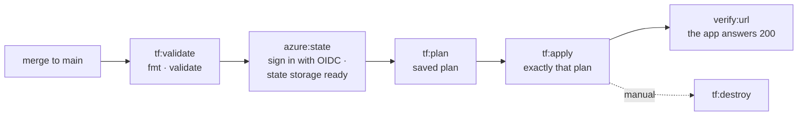
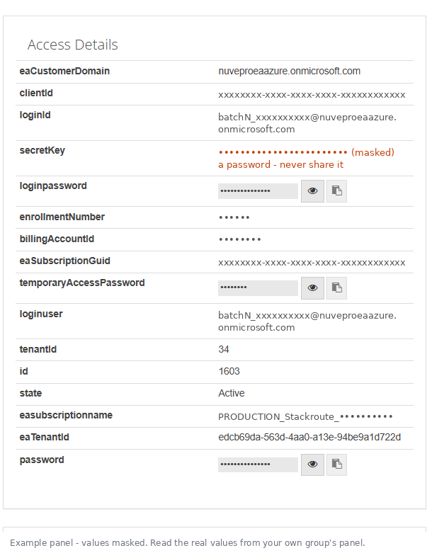

# Session 12 · CI/CD to Azure — Terraform, signed in with OIDC

**For your group's Maintainers** (two per group). About 40 minutes, the first time.

By the end, every merge to `main` does this on its own:



Merge requests and other branches run only `tf:validate` — nothing touches Azure until the code
is on `main`, through the gate.

> **Has your facilitator already run the setup for all groups?** Then your app registration, its
> role and the three GitLab variables already exist — check *Settings → CI/CD → Variables* for
> `AZURE_OIDC_CLIENT_ID`. If it is there, **skip steps 1 and 3** and go straight to step 2.

## Why OIDC — and what it replaces

| | Service principal secret (what the group has now) | **OIDC** (what you set up today) |
|---|---|---|
| What GitLab stores | A password (`AZURE_CLIENT_SECRET`) | Nothing secret — only IDs |
| What the job gets | The same password, every run | A **short-lived token** GitLab signs for *this* job |
| Who can use it | Anyone who reads the variable, from anywhere, until it expires | Only a pipeline on **`main` of your project** — Azure checks the token says exactly that |
| If it leaks | Revoke and rotate | A token is useless after a few minutes |

How the trust works: GitLab gives each job an ID token signed with GitLab's key. It says *"I am a
pipeline of project `mindsprint-group1/case-a-nova-retail`, on branch `main`"*. Azure has a
**federated credential** on your app registration that says *"trust tokens from
`https://gitlab.stackroute.in` whose subject is exactly that"*. Azure checks the signature against
GitLab's published keys, then hands the job an Azure token for an hour. No password anywhere.

> We checked: `https://gitlab.stackroute.in/.well-known/openid-configuration` is publicly
> reachable, so Azure can verify GitLab's tokens.

## What you need

- **Maintainer** on your group's GitLab project (to add variables).
- **Azure CLI** signed in to your group's lab subscription (next section).
- Your project path, exactly as in its URL — for example `mindsprint-group1/case-a-nova-retail`.
- The files in this folder: `setup-oidc.sh` / `.ps1`, `ci/azure-deploy.yml`, `infra-cd-test/`.

## Which vlabs panel values go where

Open your group's lab in vlabs (StackRoute Lab Control Panel). If the status is not
**Start – Complete**, click **Start** and wait. The **Access Details** table has more fields than
you need:



This is where each one goes:

| vlabs panel field | Used for | Goes into | Secret? |
|---|---|---|---|
| **`loginId`** | Your own sign-in for step 1 | `az login` on the Maintainer's laptop — **never into GitLab** | Username |
| **`loginpassword`** | Your own sign-in for step 1 | `az login` — typed in the browser, nowhere else | **Yes** |
| **`eaSubscriptionGuid`** | Which subscription the pipeline deploys to | GitLab variable **`AZURE_SUBSCRIPTION_ID`** | No |
| **`eaTenantId`** | Which directory Azure checks the token in | GitLab variable **`AZURE_TENANT_ID`** | No |
| `clientId` | The group's service principal — **fallback only** | GitLab variable `AZURE_CLIENT_ID` | No |
| `secretKey` | Its password — **fallback only** | GitLab variable `AZURE_CLIENT_SECRET` — Masked **and** Protected | **Yes** |
| `password`, `temporaryAccessPassword` | Not used here | — | — |
| `loginuser` | Same value as `loginId` | — | — |
| **`tenantId`** (a short number, e.g. 34) | **Not the Azure tenant** — a vlabs record number | — never use it as `AZURE_TENANT_ID` | — |
| `eaCustomerDomain`, `enrollmentNumber`, `billingAccountId`, `id`, `state`, `easubscriptionname` | vlabs bookkeeping | — | — |
| *(not on the panel)* the **app ID** that `setup-oidc` prints | The OIDC identity | GitLab variable **`AZURE_OIDC_CLIENT_ID`** | No |

**Your facilitator has already put the bottom four at group level** (*Group → Settings → CI/CD →
Variables*: `AZURE_TENANT_ID`, `AZURE_SUBSCRIPTION_ID`, `AZURE_CLIENT_ID`, `AZURE_CLIENT_SECRET`).
In your project they show under *Group variables (inherited)*. Check that `AZURE_SUBSCRIPTION_ID`
matches `eaSubscriptionGuid` on your panel. Only if they are missing, add them yourself at project
level, with the visibility in the table.

With OIDC working, the pipeline no longer needs `clientId` or `secretKey` at all — that is the point.
(If the panel ever shows a new `secretKey` after a reset, the fallback breaks until the variable is
updated; OIDC does not have that problem.)

**Sign in for step 1:**

```bash
az login                                     # browser opens: loginId + loginpassword (not "password")
az account set --subscription <eaSubscriptionGuid>
az account show --query "{name:name, id:id, tenant:tenantId}" -o table   # id = eaSubscriptionGuid, tenant = eaTenantId
```

> Never paste `loginpassword` or `secretKey` into a file, a commit, a chat or a screenshot.

---

## Step 1 · Create the identity and the trust (Maintainer, 10 min)

```bash
cd path/to/azure-labs/09b-session12-cicd-oidc
chmod +x setup-oidc.sh                                        # first time only
./setup-oidc.sh mindsprint-group1/case-a-nova-retail
```
```powershell
cd path\to\azure-labs\09b-session12-cicd-oidc
powershell -ExecutionPolicy Bypass -File .\setup-oidc.ps1 -Project mindsprint-group1/case-a-nova-retail
```

Run it after the sign-in above, so it works in your group's subscription and directory.
It creates (or reuses) an app registration named `gitlab-<group>-<project>`, adds **one**
federated credential for branch `main`, and prints the value for step 3.

**About the role.** The app needs *Contributor* on your subscription to deploy. Your lab role
cannot grant roles (`roleAssignments/write` is denied), so the script prints one line like this —
**send it to your facilitator**, who asks the subscription owner:

```text
az role assignment create --assignee <app id> --role Contributor --scope /subscriptions/<subscription id>
```

You do not have to wait: until the role is granted, the pipeline uses your group's existing service
principal (step 3, *fallback*). Everything else works the same.

## Step 2 · Add the files to your repository (on a branch, 5 min)

```bash
git switch main && git pull && git switch -c ci/azure-deploy
cp -r path/to/09b-session12-cicd-oidc/infra-cd-test .
cp path/to/09b-session12-cicd-oidc/ci/azure-deploy.yml ci/
```

Then add one line to the `include:` list in your `.gitlab-ci.yml`:

```yaml
include:
  - local: ci/ai-review.yml
  - local: ci/azure-deploy.yml        # add this
```

**If your `.gitlab-ci.yml` has a `stages:` list**, it must contain `test` and `deploy`, e.g.
`stages: [check, test, deploy]`. (No `stages:` list? Nothing to do — GitLab's defaults have both.)

Commit and push. Open a merge request. On the branch you will see only **`tf:validate`** — that is
correct: Azure is only touched from `main`.

## Step 3 · Add the variable (Maintainer, 2 min)

*Project → Settings → CI/CD → Variables → Add variable*

| Key | Value | Visibility | Protect variable | Why |
|---|---|---|---|---|
| `AZURE_OIDC_CLIENT_ID` | the app ID from step 1 | Visible — it is an ID, not a secret | **On** | Only `main` pipelines need it |

Your group already has these two (your facilitator set them at group level) — check they are listed
under *Group variables (inherited)*:

| Key | What | vlabs panel field |
|---|---|---|
| `AZURE_TENANT_ID` | Your lab directory | `eaTenantId` |
| `AZURE_SUBSCRIPTION_ID` | Your group's subscription | `eaSubscriptionGuid` |

**Fallback, automatic:** while `AZURE_OIDC_CLIENT_ID` is missing — or the role in step 1 is not
granted yet and you leave it out — the jobs sign in with the group's service principal
(`AZURE_CLIENT_ID` + `AZURE_CLIENT_SECRET`, protected, set by your facilitator). The job log says
which one it used:

```text
Azure sign-in: OIDC - short-lived GitLab token, no secret stored
Azure sign-in: team service principal secret (fallback - set AZURE_OIDC_CLIENT_ID to switch to OIDC)
```

> Add `AZURE_OIDC_CLIENT_ID` **after** the role is granted. With the variable set but no role, the
> sign-in works and every Azure call then fails with `AuthorizationFailed`.

## Step 4 · Merge, and watch it deploy (10 min)

A groupmate approves; merge through the gate. Open **Build → Pipelines** → the `main` pipeline:

| Job | What you should see in its log |
|---|---|
| `tf:validate` | `Success! The configuration is valid.` |
| `azure:state` | `Azure sign-in: OIDC …`, `Signed in as …`, and on the first run `Creating the Terraform state account sttf…` |
| `tf:plan` | `Plan: 4 to add, 0 to change, 0 to destroy.` |
| `tf:apply` | `Apply complete! Resources: 4 added` and `APP_URL=https://ca-cd1….azurecontainerapps.io` (first run: 3–6 minutes — the Container Apps environment is slow to create) |
| `verify:url` | `try 1: https://… -> 200` |

Then **Operate → Environments → azure-test → Open**: your test app, deployed by the pipeline, signed
in without a password. Note the deployment row in `infra/deployments.md` if you keep one.

## Step 5 · Change something and watch it roll out (5 min)

On a new branch, change the image in `infra-cd-test/variables.tf`:

```hcl
default = "mcr.microsoft.com/azuredocs/containerapps-helloworld:latest"
```

Merge request → merge. This time `tf:plan` says **`0 to add, 1 to change, 0 to destroy`** and the
page changes. To roll back: revert the merge request — the pipeline deploys the previous image.

## Step 6 · Tidy up

- **End of the day:** in the latest `main` pipeline, press ▶ on **`tf:destroy`**. (The lab is also
  cleaned about every four hours. That is fine: the next pipeline re-creates the state storage and
  the app from code.)
- **End of the programme:** delete the app registration — `az ad app delete --id <app id>` — and ask
  for the role to be removed.

## What is next

`TF_ROOT` in `ci/azure-deploy.yml` says which Terraform folder the pipeline deploys. When your own
`infra/` (from `DEPLOY-EXERCISE.md`) works from the CLI, set `TF_ROOT: infra` in a merge request and the
pipeline deploys your component instead — with its own state file. Building your image in the
pipeline (`az acr build`), Key Vault and managed identity for the app itself come in Sessions 16–17.

---

## When it goes wrong

| You see | It means | Do this |
|---|---|---|
| Only `tf:validate` ran on `main` | The azure jobs' rules did not match | Is the default branch `main`? Is `ci/azure-deploy.yml` in `include:`? |
| `jobs … stage deploy is not defined` | Your `stages:` list lacks `deploy` | Add `deploy` (and `test`) to it |
| `No Azure identity: add AZURE_OIDC_CLIENT_ID` | Neither OIDC nor the fallback variables reach the job | Variables protected but branch not protected? `main` must be protected |
| `AADSTS70021` / `AADSTS700213: No matching federated identity record` | The token's subject does not match the federated credential | Project path or branch typed differently (case matters). Re-run step 1 with the exact path |
| `AADSTS50166` / `AADSTS700211` (issuer) | Azure could not fetch GitLab's keys at that moment | Retry the job; if it repeats, tell your facilitator and use the fallback |
| `AuthorizationFailed` | Signed in, but the app has no role yet | Step 1's role is not granted (or not yet active - wait 5–10 minutes). Remove `AZURE_OIDC_CLIENT_ID` to use the fallback meanwhile |
| `RequestDisallowedByPolicy` | Region or resource type refused by the lab policy | Keep `eastus`; Container Apps, Storage and Log Analytics are allowed |
| `MissingSubscriptionRegistration … Microsoft.App` | Provider not registered in your subscription | Once, from your laptop: `az provider register -n Microsoft.App` and `-n Microsoft.OperationalInsights` |
| `Error acquiring the state lock` | A cancelled job left the lock | Make sure nothing is running, then re-run; if it persists, break the lease on the blob in `rg-tfstate` (portal → container `tfstate` → blob → *Break lease*) |
| `verify:url` times out | The app is still starting, or crashed | `az containerapp logs show -n ca-cd<N> -g rg-cd<N> --follow` |

## For the facilitator

- **With Owner rights, do it for all groups at once:** `gitlab-setup/setup-oidc-all.cmd` (fill
  `oidc-groups.csv` with each group's `eaSubscriptionGuid` first; `-DryRun` to preview). It creates the
  app registrations, federated credentials and Contributor roles, registers the providers, and sets
  the three GitLab variables. See `gitlab-setup/README-oidc.md`.
- Without Owner: each group's app registration needs **Contributor on its subscription** — one
  command per group, printed by step 1, run by the subscription owner (vlabs).
- The fallback uses the group-level variables you set with `gitlab-setup/setup-team-cicd`
  (`AZURE_CLIENT_ID`, `AZURE_CLIENT_SECRET` protected, `AZURE_TENANT_ID`, `AZURE_SUBSCRIPTION_ID`).
- Nothing here needs a Claude token or any key for an AI service.
